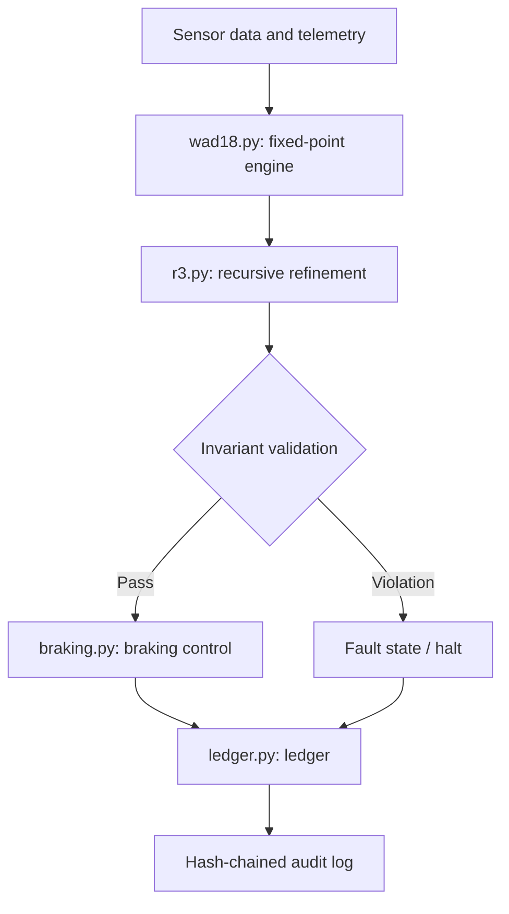

# RUAX-CAI Transportation Rail Sentinell

Deterministic fixed-point safety-monitoring and decision logic for transportation systems, written in Python with no external dependencies. The first module, **WAD18 Rail Sentinel**, covers rail braking and control.

**Author:** Michael Aaron Russell ([ORCID 0009-0001-3360-6709](https://orcid.org/0009-0001-3360-6709))
**Status:** Research prototype. Not certified or approved for use in operational transportation systems. See [Status and Limitations](#status-and-limitations).

## Overview

Floating-point arithmetic can give results that differ across platforms, compilers, and operation orderings. RUAX-CAI Transportation does all calculations in integer fixed-point arithmetic scaled by 10^18 (WAD), so the same inputs produce the same outputs on every node. Each decision is checked against explicit safety invariants and written to a hash-chained ledger for audit.

## Architecture



## Modules

| Module | Purpose |
|---|---|
| `wad18.py` | Integer fixed-point arithmetic (10^18 scale): add, subtract, multiply, divide, rounding rules |
| `r3.py` | Russell Recursive Refinement: iterative state checking against safety invariants |
| `braking.py` | Braking calculations and enforced operating limits |
| `ledger.py` | Append-only, hash-chained record of inputs, decisions, and faults |

## Safety Invariants

List each invariant the code enforces, for example:

| ID | Invariant | Enforced in |
|----|-----------|-------------|
| INV-1 | `<e.g. computed braking distance <= available distance minus margin>` | `braking.py` |
| INV-2 | `<e.g. speed never exceeds the segment limit>` | `braking.py` |
| INV-3 | `<e.g. ledger chain verifies end to end>` | `ledger.py` |

## Getting Started

Requires Python `<version>`. There are no third-party dependencies.

```bash
git clone <repo-url>
cd <repo>
python -m unittest discover tests
```

### Example

```python
# <minimal working example: build inputs, run a braking decision, verify the ledger>
```

## Determinism

- All arithmetic uses Python integers, with rounding rules documented in `wad18.py`.
- Integer arithmetic removes floating-point drift. It does not remove sensor error, model error, or specification error.
- Reproducibility is tested by `<test name>`, which replays recorded inputs and compares the outputs and ledger hashes.

## Status and Limitations

- **Not certified.** This software has not been assessed under EN 50126/50128/50129, IEC 61508, or any other railway safety standard, and has no assigned SIL.
- **Not for operational use.** It must not control live braking or signalling.
- **Braking models are simplified.** `<describe the physics model and its assumptions>`
- **Test coverage:** `<state what is tested and what is not>`
- **Hardware and timing:** real-time behavior, sensor validation, and fail-safe hardware interfaces are out of scope.

## Roadmap

- [ ] Documented invariant list with a test for each
- [ ] Property-based and fault-injection tests
- [ ] Independent review of the braking model
- [ ] Standards gap analysis (EN 50128 / IEC 61508)
- [ ] Additional transportation modules beyond rail

## Citation

```
Russell, M. A. RUAX-CAI Transportation (WAD18 Rail Sentinel). ORCID 0009-0001-3360-6709.
```

## Author and Affiliation

Michael Aaron Russell. Affiliations: Universal Standard Axiom Corporation (USAC), Advanceer IVS LLC, Foundation for Aligned Intelligence, Truth, and Humanity (FAITH).

## License

`<license>`
